 

 

<table>
<tr>
<td align="center" width="180"><a href="https://in.linkedin.com/in/vidhaan-mathur-a2b54337a"><b>◇ LINKEDIN ↗</b></a> PROFESSIONAL</td>
<td align="center" width="180"><a href="https://github.com/vidhaanm07"><b>◇ GITHUB ↗</b></a> PROJECTS</td>
<td align="center" width="180"><a href="https://leetcode.com/u/vidhaanm07/"><b>◇ LEETCODE ↗</b></a> PROBLEM SOLVING</td>
<td align="center" width="180"><a href="https://vidhaanmportfolio.vercel.app/"><b>◇ PORTFOLIO ↗</b></a> MY WORK</td>
</tr>
</table>

SOFTWARE ENGINEER • AI BUILDER • ELECTRONICS ENGINEER • PHOTOGRAPHER

 

## `01 — PROFILE`

Electronics Engineering student focused on becoming a **Software Engineer**, building at the intersection of
**`SOFTWARE × AI × ELECTRONICS × IoT`**

 

## `02 — CORE DOMAINS`

| SOFTWARE | ARTIFICIAL INTELLIGENCE | ENGINEERING |
|:---:|:---:|:---:|
| Python • C / C++ | GenAI • LLMs | Electronics • Instrumentation |
| MySQL • DSA | AI Agents • NLP | IoT • Sensors |
| APIs • Automation | RAG • MCP | Digital & Analog Systems |

 

## `03 — TECHNOLOGY STACK`

| CATEGORY | TOOLS |
|:---:|:---|
| **AI** | `GenAI` `LLMs` `AI Agents` `NLP` `RAG` `MCP` |
| **AUTOMATION** | `n8n` `OpenAI SDK` `LangChain` `Vapi` `Clay AI` |
| **ML / NLP** | `Transformers` `Hugging Face` `Gradio` |
| **ENGINEERING** | `Digital Electronics` `Analog Electronics` `Instrumentation` `Sensors` `IoT` |

 

## `04 — FEATURED WORK`

| PROJECT | STACK | HIGHLIGHTS |
|:---|:---|:---|
| **CloudNest AI** | `n8n` `LLMs` `Google Sheets` `APIs` | Ticket classification, sentiment & priority detection, team assignment, human-in-the-loop |
| **Multimodal AI Lab** | `Hugging Face` `Transformers` `Gradio` | Whisper, BLIP, MobileNet across text, image, audio & video pipelines |
| **Hotel Database System** | `Python` `MySQL` | Structured database operations, data management & application workflows |
| **IoT Simulation** | `Autodesk Tinkercad` | Sensors, circuits & embedded concepts |

`CUSTOMER TICKET` → `AI ANALYSIS` → `ASSIGNMENT` → `RESOLUTION` &nbsp;·&nbsp; CloudNest AI workflow

 

## `05 — AI / AUTOMATION`

| FOCUS | WHAT I DO |
|:---:|:---|
| **AI Agents** | Workflows where LLMs reason, use tools and perform actions |
| **Generative AI** | LLM applications and intelligent interfaces |
| **MCP** | Tool-connected AI systems |
| **Automation** | Practical workflows with n8n, APIs, AI models & external services |

 

## `06 — EXPERIENCE & LEARNING`

| PROGRAM | FOCUS |
|:---|:---|
| **IIT Jammu — AI Internship** | Gen AI, LLMs & AI Agents • `n8n` `NLP` `Vapi` `Clay AI` `OpenAI SDK` `Transformers` `Hugging Face` `Gradio` Telegram / WhatsApp Bots |
| **Anthropic Claude with Vertex AI + MCP Advanced** | `MCP` `AI Agents` `RAG` `LLM Applications` |
| **n8n Academy — n8n102** | Integrations |
| **Google Cloud Arcade Facilitator 2026** | Cloud learning program |

 

## `07 — BEYOND CODE`

**PHOTOGRAPHY** &nbsp;•&nbsp; FAPS Core Team Photographer &nbsp;•&nbsp; 🌍 **25+ Countries**

Exploring technology, places and perspective through photography.

 

 

## `08 — GITHUB SIGNAL`

 

## `09 — CONNECT`

<table>
<tr>
<td align="center" width="180"><a href="https://in.linkedin.com/in/vidhaan-mathur-a2b54337a"><b>◇ LINKEDIN ↗</b></a> PROFESSIONAL</td>
<td align="center" width="180"><a href="https://github.com/vidhaanm07"><b>◇ GITHUB ↗</b></a> OPEN SOURCE</td>
<td align="center" width="180"><a href="https://leetcode.com/u/vidhaanm07/"><b>◇ LEETCODE ↗</b></a> DSA / PROBLEM SOLVING</td>
<td align="center" width="180"><a href="https://vidhaanmportfolio.vercel.app/"><b>◇ PORTFOLIO ↗</b></a> SELECTED WORK</td>
</tr>
</table>

 

 

BUILD • LEARN • EXPERIMENT • REPEAT

